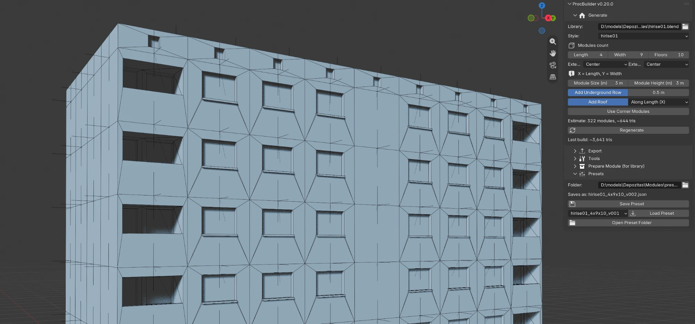

# ProcBuilder — Tutorial (v0.20.0)

A Blender add-on that assembles a rectangular box-style building from your modules (bottom/middle/top/roof/underground/balcony, using an N×N m grid), lets you select and replace individual blocks, and exports the finished building as a single clean mesh (FBX, for Unity and other engines). It also includes a separate **Tools** section for post-processing arbitrary geometry, such as parapets and mesh cleanup, independently of the generator.

The add-on version is always shown in the panel header (`ProcBuilder vX.Y.Z`), making it easy to verify that a reinstall actually updated the add-on.



**Related projects:** [ModuleModo](https://github.com/Ivanou-Dzmitry/ModuleModo) generates the low-poly wall modules that ProcBuilder assembles; [ConstructionBuilder](https://github.com/Ivanou-Dzmitry/construction-builder) builds the frame of a building under construction.

---

## 1. Installation

1. Build the archive or use the existing `dist\procedure_building.zip`
2. In Blender, select **Edit → Preferences → Get Extensions → Install from Disk** and select `procedure_building.zip`.
3. Enable the **ProcBuilder** add-on if it is not enabled automatically.
4. Open **3D Viewport → N-panel (right side) → ProcBuilder**.

The panel's sections (**Generate**, **Edit Block**, **Export**, **Tools**,
**Prepare Module**) are collapsible - click the arrow to the left of a
section's title. **Generate** and **Edit Block** start expanded (used
most often); **Export**/**Tools**/**Prepare Module** start collapsed
(not always needed). Each section remembers its own expanded/collapsed
state across sessions.

---

## 2. Overview

### Terminology

- **Module** — one building block: a 3D object (or several meshes that always belong together) that the add-on places repeatedly as a **Collection Instance**. A Collection Instance is not a copy of the mesh, but a reference to a shared collection; swapping a module simply points the same object to another collection. One module fills one grid cell: `module_size × module_size` meters in plan and `module_height` in height, or its own measured height for `bottom` and roof modules (see **Generate**).
- **Band** — the role of a module: `bottom` (ground floor), `middle` (all intermediate floors), `top` (top floor), `roof`, `underground` (an extra row below the ground floor), `balcony`, or `bottomcorner`/`middlecorner` (a dedicated corner piece; see **Corner modules**). The same band can apply to multiple floors, such as `middle` for every intermediate floor.
- **Style** — a set of modules with the same visual appearance (brick, concrete, panel, and so on), grouped under a common name: `PB_<band>_<Style>`. One library can contain multiple styles, which you select from the **Style** dropdown.
- **Balcony** — a special type of module. Unlike bottom/middle/top/roof/underground modules, balconies are **not placed automatically** by Generate. Add them manually, one at a time, to an already-generated wall block with **Add Balcony to Selected** (see **Edit Block**). A balcony is an extra object attached to the selected wall, so you decide which floor and side gets one rather than placing one on every cell.
- **Library** — a separate `.blend` file that contains all modules, grouped into collections named `PB_<band>_<Style>`. The working file, where the building is assembled, is a different file. The add-on links (`bpy.data.libraries.load`) the required collections from the library on demand instead of copying everything at once.

All building modules must be stored in a separate `.blend` library file. The module is identified **by its collection name**, not by its contents:

```text
PB_bottom_<Style>
PB_middle_<Style>
PB_top_<Style>
PB_balcony_<Style>
PB_roof_<Style>
PB_underground_<Style>
```

`<Style>` can be any name, such as `Brick01` or `Concrete`, and groups the modules into one visual style. Only `bottom` is required. Other bands are optional: if `middle` or `top` is missing, the add-on uses `bottom` with a warning; if `roof` or `underground` is missing, that optional step is skipped.

The building is assembled from regular Collection Instance objects, not Geometry Nodes. Each block is a separate object in the scene, so you can select it and change which collection it displays.

The module origin must be on the wall plane, at the bottom and centered across its width: local `(0,0,0)` is the bottom-center-front point. The add-on measures the bounding box and corrects a small X-axis offset automatically. It does not correct the origin's Y position: local Y=0 is treated as the wall plane. This matters for protruding details such as windowsills, cornices, or trim. They can extend into +Y without affecting alignment, but the origin itself must remain on the wall plane.

The **only** thing the add-on cannot determine automatically is which side of the module is the front. The module's front face, which should face outward from the building, must point toward local **+Y**. The add-on rotates modules by 0/90/180/270 degrees without moving them. If the front face points in the wrong direction, the building will be oriented incorrectly.

A **corner module is optional and disabled by default**. Without one, each of the four walls spans the full length or width of the building, including the corner cells. Two modules meet at each corner, one from each wall. This works well for flat, zero-thickness modules, but modules with real depth visibly overlap at the corner. For the `bottom` and `middle` bands, you can add a dedicated L-shaped corner module to the library. The corner then uses one object instead of two overlapping modules. See **Corner modules** below for details. If no corner module exists in the library, the building behaves as before and no changes are required.

---

## 3. Preparing modules (Prepare Module)

**Purpose:** Turn regular meshes in the scene into modules recognized by the generator by assigning the correct collection name `PB_<role>_<style>` without renaming collections manually.

**How it works:**

1. Select the object(s) that make up one module.
2. **Role** — `bottom`/`middle`/`top`/`balcony`/`roof`/`underground`, or **`bottomcorner`/`middlecorner`** (`Bottom Corner`/`Middle Corner` in the list) for a dedicated L-shaped corner module. See **Corner modules**.
3. **Variant** (next to Role) — an optional variant tag: `Plain` / `Window` / `Door` / `Corner`. Use it when one Role+Style has **multiple alternative modules**, such as a plain wall, wall with a window, and wall with a door, which can be selected with Swap at the same position. The variant is added to the collection name so the Outliner and Swap list show which module is which (`PB_bottom_t01_Win`, `PB_bottom_t01_Door`) instead of Blender's generic `.001`/`.002` suffixes.

   Do not confuse the `Corner` Variant with the dedicated corner module from **Corner modules**. Variant `Corner` creates `PB_bottom_t01_Corner`, which the generator treats as a completely different style (`t01_Corner`), not as the corner module for style `t01`. For a real corner module, use the **Role** `bottomcorner`/`middlecorner`. Variant is automatically ignored and disabled for these roles, regardless of its previous value.
4. **Style** — enter the style name, for example `Brick01`.
5. Select **Set Module Name**:
   - If the selected objects already form a separate collection, the collection is renamed.
   - Otherwise, a new collection is created with the name `PB_<role>_<style>` or `PB_<role>_<style>_<variant>` when Variant is not `Plain`, and the objects are moved into it.

Each call creates its **own** collection, even when Role and Style are the same. Without Variant, Blender adds `.001`, `.002`, and so on to duplicate collection names. This is important: alternative variants must be stored in separate collections. If you merge them into one collection, all variants are placed at every position at the same time, and Swap has only one option to offer.

**Requirements:** At least one object must be selected and **Style** must not be empty.

Repeat the process for every band in a style to create a set such as `PB_bottom_Brick01`, `PB_middle_Brick01`, `PB_top_Brick01`, and so on. Save the file; this is your module library.

### Naming objects inside a module

A single module can contain multiple meshes only when they **always appear together** as one unit, such as a wall panel with a permanently attached decorative trim. If they are **alternative variants** for the same position (plain wall / wall with window / wall with door, selected with Swap), they need separate collections instead.

After modeling, default Blender names such as `Cube.003` are difficult to read in the Outliner. Use this format:

`<collection name, abbreviated band>.<part>`

For example, collection `PB_middle_Type01` produces object `PB_mid_Type01.wall`. Band abbreviations are `bottom→bot`, `middle→mid`, `top→top`, and `underground→uground`; `balcony` and `roof` keep their full names. The style name and any collection suffix such as `.002` are preserved.

**Set Element Name** — select object(s) inside a module collection, choose **Part** (`Wall`/`Door`/`Window`/`Balcony`/`FlatWall`/`Frame`/`Sill`/`Trim`), and select the button. Each object is renamed to `<collection>.<part>`.

**Rename All In Collection** — renames all objects in the active object's collection, using their current names as the part name. For example, if your meshes are already named `Wall`, `Door`, and `Window`, one click gives them the `<collection>.Wall`, `<collection>.Door`, and `<collection>.Window` names. You do not need to select a Part for each object. It is safe to run repeatedly; an existing collection prefix is not added twice.

**Requirements:** The object must belong to a collection. For a meaningful result, the collection should already follow the `PB_<band>_<style>` convention created with **Set Module Name**. Otherwise the operation is skipped without an error. Only objects are renamed; the collection is not changed.

---

## 3a. Corner modules (optional, bottom/middle only)

Without a corner module, each corner contains **two overlapping regular wall modules**. A corner module is a **single L-shaped piece** that occupies the whole corner without overlapping geometry. It is supported only for the **bottom** and **middle** bands; `top` corners continue to use the existing overlapping behavior.

The feature is optional in two ways. First, **Use Corner Modules** in the Generate section is off by default. When it is off, corners always use the overlapping wall modules even if a corner module exists in the library. Second, if the current style does not contain `PB_bottomcorner_<style>` or `PB_middlecorner_<style>`, the build falls back to the overlapping behavior with a warning. Existing libraries do not need to be changed.

### How to model a corner module

The corner module uses a separate convention from regular walls and is authored for the **North-West** corner. As with regular walls, the reference North side uses 0° rotation; the West side is also authored at 0° and is built into the mesh as a +90°-rotated arm.

The module consists of **two arms**, each using the same "front face at local Y=0, facing +Y" convention as a regular wall panel. One arm is rotated +90° directly in the mesh rather than by the add-on:

1. **North arm** — build it exactly like a regular wall panel: front at local Y=0, facing +Y. Place it so its **corner edge**, not its center, is at the object origin `(0,0,0)`. It should extend from the origin along local **+X** for exactly one Module Size.
2. **West arm** — use another panel with the same front-face convention and **rotate it +90°** around the origin in the 3D editor. Its front face then points toward local **-X**. Place it so it extends from the origin along local **-Y** for one Module Size.
3. Join both arms into one object or collection. The point where the arms meet must be **exactly on the outer grid corner**, at floor level (Z=0). Unlike regular modules, the corner module is not centered automatically by its bounding box; this point is used as-is.
4. Select **Set Module Name** → Role = `Bottom Corner` or `Middle Corner`, Variant = `Plain`, and the same Style used by the other modules. This creates `PB_bottomcorner_<style>` or `PB_middlecorner_<style>`.

The add-on rotates this one modeled piece by 0°/90°/180°/270° to cover all four corners (North-West/South-West/South-East/North-East). Model only one L-shaped module per band.

**If the corner appears in the wrong place**, such as floating beside the wall or near the middle of a wall, check these two points:

1. **The point where the two L-shaped arms meet** — in the library file's world coordinates, the geometry must meet exactly at `(0,0,0)`. Joining or moving objects manually can shift the geometry even when the origin marker appears correct.
2. **The collection's Instance Offset** — this is a property of the collection, not the object. Find it under Object Properties → Collection → Instance Offset when the collection is active in the Outliner. When a collection is created through `Move to Collection → New Collection`, Blender uses the 3D cursor's current position as the Instance Offset. If the cursor was not at the corner point, the offset can be arbitrary.

Starting with v0.18.2, the add-on automatically compensates for the collection's Instance Offset, regardless of its value, so you normally do not need to change it. If the geometry itself is offset, fix it manually: select the meshes of both arms, use `Object → Set Origin → Origin to 3D Cursor` after placing the cursor on the corner vertex with `Shift+S → Cursor to Selected`, then move the object (`G`) so its origin is exactly at world `(0, 0, 0)` in the library file.

The module height follows the regular wall module for the same band. `bottomcorner` uses its own measured height, following the same automatic-height logic as `bottom` (see **Generate**).

The corner geometry and rotations are verified by the `smoke_test_corner.py` automated test. The corner module connects to adjacent straight modules without gaps or overlaps at all four corners.

---

## 4. Building the house (Generate)

| Field | Description |
|---|---|
| **Library** | Path to the `.blend` file containing the modules. |
| **Style** | Style loaded automatically from the library. |
| **Length / Width / Floors** | Dimensions **in modules**, not meters. |
| **Extend X / Extend Y** | Controls which direction the building grows on each axis when Length/Width changes. See below. |
| **Module Size / Module Height** | Real-world size of one module in meters (3×3 m by default). Change these values if your modules use a different size, or you may get gaps or overlaps. |
| **Add Underground Row** (+ height) | Adds an extra wall row below floor 0. See below. |
| **Add Roof** (+ direction) | Adds a flat cap over the building. See below. |
| **Use Corner Modules** | Off by default. See **Corner modules**. |

**Use Corner Modules** is independent of whether the library contains corner modules:

- **Off (default)** — corners use two overlapping straight modules, even if `PB_bottomcorner_<style>` or `PB_middlecorner_<style>` exists. You can keep corner modules in the library and still use regular corners for a particular build.
- **On, and the style has a corner module** — the corner module is used.
- **On, but the current style has no corner module** — the build falls back to the overlapping corner behavior and shows a warning such as `Style '<style>' is missing module(s) for: bottomcorner (skipped)`.

Before you click Generate, the panel displays **Estimate: N modules, ~X tris** above the button. This estimate uses the actual geometry in the library and reflects the current Library, Style, Length/Width/Floors, Underground/Roof, and Use Corner Modules settings. Use it to gauge scene complexity before generating the building, especially when increasing the number of floors or the building size.

Click **Generate**. If a building already exists, the button becomes **Regenerate**; the existing build is removed and rebuilt.

The result is a `Building` collection. Floor 0 uses the `bottom` band, the last floor uses `top`, and the floors between them use `middle`.

The panel also displays **Last build: ~X tris**, which is the actual triangle count for the generated building. This value updates automatically after **Swap Selected**, **Swap All Matching**, **Fill Selected Side**, and **Add Balcony to Selected**, without requiring a full Regenerate, because these operations change the modules in the build and therefore its polygon count.

The panel displays triangles only to keep the UI compact. On Windows, the Blender **system console** (`Window → Toggle System Console`) prints a full report after every Generate/Regenerate, including wall/balcony/roof breakdown, vertex count, and the triangle-count difference from the previous build (`was N → +/-M`), for example:

```text
[ProcBuilder] Generated 'Brick01' 5x3x3: 48 walls, 2 balconies, 15 roof tiles
(65 instances) - ~12,400 triangles (was 9,800 → +2,600), ~6,800 vertices
(exact export count may differ slightly after vertex welding)
```

When **Floors** changes, the band for every floor is recalculated. For example, floor 2 can be `middle` in a five-floor building but become `top` when the building is reduced to three floors. If a roof is enabled, it always uses the actual height of the current top floor. Regenerate preserves manual swaps only when the slot's band remains the same. If the band changes, the slot receives the default module for its new band instead of keeping the old module, so a top module cannot accidentally keep an old middle module and place the roof at the wrong height.

### Extend X / Extend Y — control where the building grows

**X = Length, Y = Width.** The panel shows an `X = Length, Y = Width` hint below these fields.

By default, the building grows symmetrically from its center (`Center` on both axes). Use the axis controls when you need the building to grow in one direction without moving the opposite facade manually.

The two axes are independent dropdowns:

- **Extend X**: `X+` grows east while keeping the west edge in place; `X-` grows west while keeping the east edge in place; `Center` grows symmetrically in both directions.
- **Extend Y**: `Y+` grows north; `Y-` grows south; `Center` grows symmetrically in both directions.

For example, set Extend X = `Center` and Extend Y = `Y-` to grow the length symmetrically while extending the width only to the south, keeping the north facade in place.

When you change only Length or Width, existing blocks, including swaps and balconies, **stay in place**. New modules are added only at the growing edge. If you change the Extend X/Y setting itself between generations, such as from `X+` to `X-`, the existing wall moves to the opposite side because you changed which edge the building grows from. This is expected. `Center` behaves differently by design: growth is split between both sides, so existing blocks move slightly on every Regenerate even when the Extend setting itself does not change.

### Automatic height for the bottom floor

The first floor is often taller than the others. The add-on automatically measures the actual height of the `bottom` module from its bounding box and uses that height to place floor 1 and all floors above it instead of assuming it equals Module Height. There is no separate field: simply model the `bottom` module at the height you need. For example, if Module Height is 3 m, a 4 m `bottom` module places floor 1 exactly on its actual top without gaps or stretching the bottom module.

This follows the same principle as automatic roof height: each higher floor inherits the actual height of the module below it.

### Underground

**Purpose:** Sink the bottom of the building into uneven terrain so the building does not appear to float above the ground.

**How it works:** Adds an extra wall ring (`PB_underground_<Style>`) below floor 0. Its height has a separate value (0.5 m by default, usually 0.5–1 m), independent of Module Height. The module is stretched or compressed along Z to match the specified height, so the same asset can be used for different depths.

**Requirements:** The library must contain `PB_underground_<Style>`. Otherwise this step is skipped with a warning.

### Roof

**Purpose:** Close the top of the building with a solid roof.

**How it works:** Fills the entire building footprint (Length × Width modules) with `PB_roof_<Style>` tiles, similar to a Cap operation but using modules. Author the roof module exactly like a wall module (vertical plane, front face toward +Y). The add-on rotates it 90° to lay it flat with the front face upward, so no separate flat-plane convention is required. The direction dropdown (X/Y) rotates all tiles by 90° together to control board or texture direction.

The roof height is calculated automatically from the actual bounding box of the highest wall module (`top`, or `bottom` when the building has only one floor), rather than assuming it equals Module Height. This is important when the top band is shorter than a normal floor, such as a 1 m parapet row on a building with 3 m floors.

**Requirements:** The library must contain `PB_roof_<Style>`. Otherwise this step is skipped with a warning.

**Regenerate preserves manual edits.** Before rebuilding, the add-on remembers which module is used in each slot (floor + position for walls/underground, `grid_i`/`grid_j` for roof tiles) and which balconies are attached where. After rebuilding, it restores those edits for slots that still exist. If a slot disappears, for example because you reduce the building length, its swap or balcony is simply not restored.

The wall slot key is **side (N/E/S/W) + position along that side**, counted from the start of the specific wall rather than from the beginning of the full perimeter traversal. This is more reliable than a sequential perimeter index because that index depends on both Length and Width. With the old indexing approach, changing either dimension could make the same index refer to a different physical wall, causing a swap or balcony on the south wall to appear on the east wall. The current side+position key remains tied to the same physical wall regardless of Length/Width changes.

---

## 5. Replacing individual blocks (Edit Block)

The **Edit Block** section appears when you select a generated block. You can select multiple blocks at once with Shift/Ctrl-click or a selection box; the operations below apply to all selected blocks, with each block resolved according to its own band.

| Button | What it replaces |
|---|---|
| **Swap Selected** | All currently selected blocks. |
| **Swap All Matching** | Every block in the building that currently uses the same module as any selected block. |
| **Fill Selected Side** | The entire side (N/E/S/W), across all floors, to which the active block belongs. |

Select the replacement style from **Replace with**. The list is filtered to styles that have a module for the active block's band.

Corner blocks are supported too. When a corner block is selected, **Replace with** is filtered by the corner band (`bottomcorner`/`middlecorner`) instead of the regular wall band. Only styles that actually contain a corner module are offered. A style without a corner module does not appear in the list, and a regular straight wall module is never substituted into a corner slot.

**Fill Selected Side** is useful when only one facade needs detailed modules while the other three sides should use a simple filler module, such as a flat wall without windows. For example: `PB_bottom_WallFiller`, `PB_middle_WallFiller`, and `PB_top_WallFiller`. The appropriate band is selected automatically for each floor.

### Balconies

Select one or more wall blocks → choose a style under **Balcony** → select **Add Balcony to Selected**. A balcony is placed at the same position and rotation as each selected wall block. The balcony module must be modeled so that it fits the wall correctly at that position.

---

## 6. Export (Export)

**Purpose:** Export the modular building as one clean mesh for a game engine such as Unity without changing the editable building.

**How it works:** Enter a name in **Name** and select **Export FBX**:

1. The geometry of all building blocks (walls, roof, and balconies, using their actual transforms) is baked into **one new mesh** directly through `bmesh`, without Duplicate/Join operators. Those operators proved unreliable on real assets and could leave some blocks unjoined.
2. Vertices at module seams are welded using **Merge by Distance** with a 1 mm threshold.
3. The mesh is centered on X/Y and placed on the ground on Z, with Z=0 at the base rather than at the center of the building height. The exported object's origin is exactly at `(0,0,0)`, under the center of the building footprint at ground level.
4. The file is written as `<name>_v001.fbx`:
   - If **Folder** contains a path, the file is saved there.
   - If **Folder** is empty, the file is saved next to the `.blend` file.
   - If the `.blend` file has not been saved yet, the file is saved to the user's home folder. The panel always displays **Saves to: <resolved path>** so you can see the actual destination.
   - Exporting again with the same name does not overwrite the previous file. It creates `_v002.fbx`, `_v003.fbx`, and so on.
5. **Open Export Folder** opens the destination folder in Explorer/Finder using Blender's built-in `bpy.ops.wm.path_open`, which works on Windows, macOS, and Linux.
6. The temporary export object and mesh are deleted immediately after export, leaving no extra data behind. The `Building` collection itself is not modified.

**Requirements:** A building must already be generated and the `Building` collection must exist.

---

## 7. Tools — post-processing arbitrary geometry

This is a separate group **not connected to the generator**. It works on any mesh in Edit Mode, usually on already exported or merged building geometry, but it can be used with any object.

### Make Parapet From Selection

**Purpose:** Quickly create a decorative parapet or cap with a diamond-shaped profile along selected edges, without manually going through six menu operations.

**How it works:** One click runs the entire pipeline:

1. `Mesh → Separate → Selection` — selected edges are moved to a new object.
2. `Object → Convert → Curve`.
3. `Bevel: Depth = <Depth>, Resolution = <Resolution>`. Resolution 0 creates a square profile; higher values create a rounded profile, up to an almost circular profile.
4. Set `Tilt = 45°` for every spline point so the profile is oriented as a diamond.
5. **At corner points where the curve direction actually changes, the profile radius is multiplied by `1 / cos(turn angle / 2)`.** Without this compensation, the profile appears narrower at sharp, usually 90° corners. This is a standard POLY curve bevel artifact: Blender orients the profile along the angle bisector, reducing its visible width along the wall by `cos(45°) ≈ 0.71`. The radius is not changed on straight sections where the direction does not change.
6. `Convert to Mesh`.

The result is a new **Parapet** object. The original object no longer contains the selected edges because they were moved to Parapet by Separate.

The corner compensation formula (`1/cos(turn angle/2)`) works for any profile. It scales the curve point's `radius` and does not depend on the cross-section shape, so a round parapet also connects correctly at corners without narrowing.

**Requirements:** The active mode must be Edit Mode on a mesh object, and some edges must be selected. Otherwise the operation reports `Nothing was separated`. The **Depth** field defaults to 0.2 m and **Resolution** defaults to 0.

Because building walls are usually zero-thickness planes, the parapet profile extends **symmetrically on both sides** of the wall plane. The same strip appears outside and inside the building at the same distance (`radius`/`Depth`) from the original edge. This is expected: the bevel profile is centered on the curve, and the curve lies directly on the zero-thickness wall plane.

> An experimental **Remove Interior Faces** button was removed in v0.9.1. It used a ray-cast point-in-solid test to find and delete faces buried inside other geometry. The approach works for closed solid volumes, such as intersecting cubes, but building walls are flat, zero-thickness faces rather than closed volumes, so the point-in-mesh test was unreliable on real building geometry. It could delete the wrong face or do nothing. No reliable solution for flat geometry was found in a reasonable amount of time, so the unreliable tool was removed.

---

## 7a. Presets — rebuild a building you assembled

**Purpose:** you built a building and tuned modules by hand — and want to get
it back (or something close to it) later without redoing everything.

The **Presets** section (bottom of the panel, collapsed by default):

- **Save Preset** — writes a `.json` file containing:
  - every **Generate** setting: library, style, Length/Width/Floors,
    Extend X/Y, Module Size/Height, Underground (+ height), Roof
    (+ direction), Use Corner Modules;
  - the current building's **manual edits**: swapped wall and roof-tile
    modules, and added balconies. Slots still holding their style's default
    module aren't written - they come back as the default on load anyway.

  The file name is built from the building's parameters:
  `<style>_<Length>x<Width>x<Floors>_v001.json`, e.g. `t01_3x23x6_v001.json`.
  The label under the button always shows the next file name (**Saves as**).
  Saving again with the same parameters **never overwrites** an earlier file:
  it creates `_v002`, `_v003`... (same as Export). With no building in the
  scene, only the settings are saved.
- **Load Preset** (dropdown left of the button, newest files first) —
  applies the preset's settings, **rebuilds the building** (the current
  `Building` is replaced) and puts the manual edits back in the same slots.
  Before loading it checks that the preset's library exists and contains the
  style - if not you get an error and your settings stay untouched. A module
  no longer present in the library falls back to the style's default one.
- **Open Preset Folder** — opens the presets folder in the OS file browser.
- **Folder** — where presets are saved to and read from. Empty means a
  `ProcBuilder/presets` folder inside Blender's config directory (on Windows:
  `%APPDATA%\Blender Foundation\Blender\<version>\config\ProcBuilder\presets`),
  which survives add-on updates. You can point it elsewhere - e.g. your
  project folder, so presets live next to the rest of your files.

A preset stores the **library path exactly as it was set** - if the files
moved to another drive, edit the path in the `.json` itself, or in the
**Library** field before saving.

---

## 8. Known limitations v1

- There are no floor slabs between stories. The generator creates walls, an optional roof, and an optional underground row.
- Dedicated corner modules are supported only for `bottom`/`middle`. Without a corner module, and always for `top`, each corner consists of two wall modules meeting at 90°. This works cleanly for flat modules; modules with real thickness or depth visibly overlap at the corner.
- Regenerate preserves wall/roof swaps and balconies for slots that still exist after rebuilding (see **Generate**). Tools objects such as **Parapet** are not part of the `Building` collection, so they remain in place unchanged during regeneration; they are not deleted or recalculated.
- There is no Asset Browser integration. Modules are discovered by collection name.
