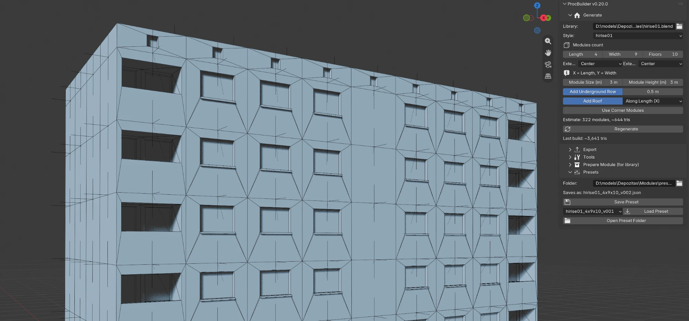

# ProcBuilder — туториал (v0.20.0)

Аддон для Blender: собирает прямоугольный дом-коробку из ваших модулей
(низ/середина/верх/крыша/подвал/балкон, сетка N×N м), даёт точечно
выделять и заменять блоки, а готовую сборку — экспортировать в один
чистый меш (FBX, для Unity и т.п.). Отдельно есть блок **Tools** —
пост-обработка произвольной геометрии (парапеты, чистка меша), не
привязанная к генератору.

Версия аддона всегда видна в заголовке панели ("ProcBuilder vX.Y.Z") —
удобно проверять, что переустановка реально подтянула новую версию.



**Связанные проекты:** [ModuleModo](https://github.com/Ivanou-Dzmitry/ModuleModo) — генерирует низкополигональные стеновые модули, из которых ProcBuilder собирает здания; [ConstructionBuilder](https://github.com/Ivanou-Dzmitry/construction-builder) — строит каркас здания на стадии стройки.

---

## 1. Установка

1. Собрать архив (или взять готовый `dist\procedure_building.zip`)
2. В Blender: **Edit → Preferences → Get Extensions** → **Install from
   Disk** → выбрать `procedure_building.zip`.
3. Включить галочку у аддона **ProcBuilder**, если не включился сам.
4. **3D Viewport → N-панель (справа) → вкладка "ProcBuilder"**.

Секции панели (**Generate**, **Edit Block**, **Export**, **Tools**,
**Prepare Module**) — сворачиваемые, кликом по стрелке слева от
заголовка. **Generate** и **Edit Block** по умолчанию раскрыты (нужны
чаще всего), **Export**/**Tools**/**Prepare Module** — свёрнуты (нужны
не всегда). Состояние разворота у каждой секции своё и запоминается
Blender'ом между сеансами.

---

## 2. Общая идея

### Термины

- **Модуль** — один "кирпичик" сборки: 3D-объект (или несколько мешей
  вместе, если они всегда идут одним куском), который аддон копирует
  много раз как **инстанс коллекции** (Collection Instance — не сам меш,
  а ссылка на общую коллекцию; поменять модуль на другой значит просто
  подставить другую коллекцию тому же объекту). Один модуль занимает одну
  клетку сетки: `module_size × module_size` метров в плане, по высоте —
  `module_height` (или собственная высота модуля для `bottom`/крыши, см.
  раздел 4).
- **Band** ("полоса"/тип модуля по вертикали или по роли) — какую роль
  играет модуль: `bottom` (нижний этаж), `middle` (все средние этажи),
  `top` (последний этаж), `roof` (крыша), `underground` (доп. ряд ниже
  нижнего этажа), `balcony` (балкон, см. ниже), `bottomcorner`/
  `middlecorner` (угловая деталь, см. раздел 3a). Один и тот же band
  может повторяться на нескольких этажах (например `middle` — сразу на
  всех промежуточных).
- **Стиль (Style)** — набор модулей одного визуального облика (кирпич,
  бетон, панель...), объединённых общим именем: `PB_<band>_<Style>`.
  Одна библиотека может содержать несколько стилей — выбираются в
  выпадающем списке **Style**.
- **Балкон** — модуль ОСОБОГО рода: в отличие от bottom/middle/top/roof/
  underground, балконы **не расставляются автоматически** при Generate —
  они добавляются только вручную, по одному, на конкретный уже
  сгенерированный стеновой блок (кнопка **Add Balcony to Selected**,
  раздел 5). То есть это не часть основного периметра стен, а
  дополнительный объект, "прикреплённый" поверх выбранной стены — решаете
  сами, на каком именно этаже/стороне он нужен, а не на каждой клетке
  подряд.
- **Библиотека** — отдельный `.blend`-файл, где лежат все модули,
  сгруппированные по коллекциям с именами `PB_<band>_<Style>` (см. ниже).
  Рабочий файл (где собирается дом) — другой файл, аддон **линкует**
  (`bpy.data.libraries.load`) нужные коллекции из библиотеки по запросу,
  не копирует всё сразу.

- Все модули (куски дома) лежат **в отдельном .blend-файле-библиотеке**.
  Рабочий файл (где собирается дом) — другой файл.
- Модуль опознаётся **по имени коллекции**, не по содержимому:
  ```
  PB_bottom_<Стиль>
  PB_middle_<Стиль>
  PB_top_<Стиль>
  PB_balcony_<Стиль>
  PB_roof_<Стиль>
  PB_underground_<Стиль>
  ```
  `<Стиль>` — любое имя (`Brick01`, `Concrete`...), объединяет один
  визуальный набор. Обязателен только `bottom`; остальные band'ы
  опциональны (нет `middle`/`top` → аддон подставит `bottom` с
  предупреждением; нет `roof`/`underground` → просто пропустит этот шаг).
- Дом собирается **обычными объектами-инстансами коллекций** (Collection
  Instance), не через Geometry Nodes. Каждый блок — отдельный объект в
  сцене: можно выделить и подменить, какую коллекцию он показывает.
- **Origin модуля должен стоять на плоскости стены, по низу и по центру
  ширины** (local `(0,0,0)` = низ-центр-перед). По ширине (X) аддон
  дополнительно подстрахует небольшую неточность — меряет bounding box и
  центрирует сам. А вот **глубина (Y) origin'а не подстраховывается** —
  берётся как есть: local Y=0 считается плоскостью стены. Это важно, если
  на стене есть выступающий элемент (подоконник, карниз, наличник) — он
  может торчать в +Y сколько угодно, это не собьёт стыковку, но сам
  origin должен быть на плоскости стены, а не смещаться выступом.
- **Единственное, что аддон не может определить сам: направление лица.**
  "Лицевая" сторона модуля (та, что смотрит наружу здания) должна смотреть
  в локальный **+Y** — аддон поворачивает модуль на 0/90/180/270°, не
  сдвигая его; если лицо смотрит не туда, весь дом "вывернется".
- **Угловой модуль — опционален, по умолчанию его нет.** Без него каждая
  из 4 стен строится на всю длину/ширину дома, включая угловые клетки —
  в каждом углу встречаются ДВА модуля (по одному от каждой стены), рёбра
  стыкуются. Для плоских (без толщины) модулей это выглядит нормально; для
  модулей с реальной глубиной в углу будет видимый нахлёст геометрии. Для
  band'ов `bottom` и `middle` можно добавить в библиотеку **отдельный
  угловой L-образный модуль** — тогда угол займёт ОДИН объект вместо двух
  нахлёстывающихся, без нахлёста геометрии. Подробности и как его
  смоделировать — в разделе 3a ниже. Если углового модуля нет в
  библиотеке — сборка ведёт себя ровно как раньше (два модуля внахлёст),
  никаких изменений не требуется.

---

## 3. Подготовка модулей (Prepare Module)

**Для чего:** превратить обычные меши в сцене в модуль, который увидит
генератор — то есть присвоить коллекции правильное имя
`PB_<role>_<style>`, не переименовывая руками.

**Как работает:**
1. Выделите объект(ы), составляющие один модуль.
2. **Role** — `bottom`/`middle`/`top`/`balcony`/`roof`/`underground`, а
   также **`bottomcorner`/`middlecorner`** ("Bottom Corner"/"Middle
   Corner" в списке) — для отдельного углового L-образного модуля,
   см. раздел 3a.
3. **Variant** (сразу справа от Role) — опциональный тег варианта:
   `Plain` / `Window` / `Door` / `Corner`. Нужен, когда для одного Role+Style
   есть НЕСКОЛЬКО альтернативных модулей (просто стена / стена с окном /
   стена с дверью), которые выбираются через Swap на одной и той же
   позиции — вариант дописывается в имя коллекции, чтобы в аутлайнере и в
   списке Swap было сразу видно, что есть что (`PB_bottom_t01_Win`,
   `PB_bottom_t01_Door`), а не бессмысленные `.001`/`.002` от Blender.
   **Не путайте с угловым модулем из раздела 3a** — Variant `Corner`
   создаёт `PB_bottom_t01_Corner`, что генератор распознает как СОВСЕМ
   ДРУГОЙ стиль (`t01_Corner`), а не как угловой модуль для стиля `t01`
   — для настоящего углового модуля используйте **Role**
   `bottomcorner`/`middlecorner`. **Variant при этом автоматически
   игнорируется** (поле блокируется в панели, серое) — раньше можно было
   случайно получить `PB_bottomcorner_t01_Corner`, если Variant остался
   на `Corner` с прошлого раза (это persistent-поле, не сбрасывается само)
   — теперь для Role = Bottom/Middle Corner Variant не применяется вообще,
   независимо от того, что в нём выбрано.
4. **Style** — имя стиля (например `Brick01`).
5. **Set Module Name**:
   - если выделенные объекты уже составляют отдельную коллекцию целиком —
     она просто **переименовывается**;
   - иначе создаётся **новая коллекция** с именем `PB_<role>_<style>` (или
     `PB_<role>_<style>_<variant>`, если Variant не `Plain`) — объекты
     переносятся в неё.

   Каждый вызов создаёт **свою** коллекцию, даже при одинаковых Role/Style
   (без Variant Blender сам добавит суффикс `.001`, `.002`...) — это важно:
   альтернативные варианты ОБЯЗАНЫ быть в разных коллекциях. Если
   объединить их в одну — на каждой позиции при генерации будут стоять ВСЕ
   варианты одновременно (наложены друг на друга), а в списке Swap
   останется только один пункт.

**Требования:** хотя бы один выделенный объект и непустое поле Style.

Повторите для каждого band'а одного стиля → получите набор
`PB_bottom_Brick01`, `PB_middle_Brick01`, `PB_top_Brick01`, ... Сохраните
файл — это и есть библиотека.

### Именование объектов внутри модуля

Внутри ОДНОГО модуля может быть несколько мешей — но только если они
**всегда должны появляться вместе** как единое целое (например стеновая
панель + приваренная к ней декоративная окантовка). Если же это
**альтернативные варианты** одного и того же места (просто стена / стена
с окном / стена с дверью — выбираете через Swap) — см. предупреждение
выше, им нужны РАЗНЫЕ коллекции, а не общая. После моделирования у мешей
стандартные Blender-имена вроде `Cube.003` — плохо читаемо в аутлайнере.
Формат имени объекта:
`<имя коллекции, band сокращён>.<часть>`, например коллекция
`PB_middle_Type01` → объект `PB_mid_Type01.wall`. Сокращения band:
`bottom→bot`, `middle→mid`, `top→top`, `underground→uground` (`balcony`/
`roof` остаются как есть); style и любой суффикс коллекции (`.002` и т.п.)
переносятся как есть.

**Set Element Name** — выделить объект(ы) внутри коллекции модуля, выбрать
**Part** (`Wall`/`Door`/`Window`/`Balcony`/`FlatWall`/`Frame`/`Sill`/`Trim`)
и нажать кнопку: каждый переименуется в `<коллекция>.<part>`. Удобно, когда
хотите явно назначить роль объекту из списка.

**Rename All In Collection** — переименовывает **сразу все** объекты в
коллекции активного объекта, используя **их же текущие имена** как
"часть" (то есть если вы уже назвали меши при моделировании `Wall`,
`Door`, `Window` — жмёте одну кнопку, и все получают префикс коллекции:
`<коллекция>.Wall`, `<коллекция>.Door`, `<коллекция>.Window`). Не требует
выбора Part по одному объекту. Безопасно нажимать повторно — если у
объекта уже есть этот префикс, второй раз он не задвоится.

**Требования:** объект должен лежать в какой-либо коллекции (для
осмысленного результата — уже названной по конвенции `PB_<band>_<style>`
через **Set Module Name**), иначе просто пропускается без ошибки.
Переименовывает только **объекты**, коллекцию не трогает.

---

## 3a. Угловой модуль (опционально, только bottom/middle)

**Для чего:** без углового модуля в каждом углу встречаются ДВА обычных
стеновых модуля внахлёст (см. раздел 2). Угловой модуль — это ОДНА
L-образная деталь, занимающая угол целиком, без нахлёста геометрии.
Работает только для band'ов **bottom** и **middle** (для `top` не
запрашивался и не поддержан — там углы как раньше, внахлёст).

**Опционально в двух смыслах сразу**: во-первых, есть галочка **Use
Corner Modules** в разделе Generate (по умолчанию снята) — без неё углы
всегда внахлёст, даже если модуль в библиотеке есть. Во-вторых, если для
стиля нет `PB_bottomcorner_<style>`/`PB_middlecorner_<style>` — сборка
ведёт себя ровно как раньше (два модуля внахлёст) даже при включённой
галочке, просто с предупреждением. Никаких изменений в существующих
библиотеках делать не обязательно.

### Как смоделировать

Авторская конвенция для углового модуля — **отдельная от обычных стен**,
привязана к углу **North-West** (как и у обычных стен reference — North,
поворот 0°, только теперь ещё и West, поворот 0°). Модуль состоит из
**двух "рук" (arms)**, каждая построена по тому же правилу "лицо в
локальном Y=0, смотрит в +Y", что и обычная стеновая панель — просто
одна из рук уже повёрнута на +90° прямо в меше, а не аддоном:

1. **"Северная" рука** — сделайте её КАК ОБЫЧНУЮ стеновую панель: лицо на
   локальном Y=0, смотрит в +Y — точно так же, как ваши bottom/middle
   модули уже сделаны. Разместите её так, чтобы **угловой край** (не
   центр!) стоял в origin объекта (0,0,0), и она уходила от origin вдоль
   локального **+X** на длину ровно в один Module Size.
2. **"Западная" рука** — возьмите такую же панель (лицо Y=0, смотрит +Y)
   и **поверните её на +90°** вокруг origin прямо в 3D-редакторе (её лицо
   после поворота будет смотреть в локальный **-X**). Разместите её так,
   чтобы она уходила от origin вдоль локального **-Y** на один Module
   Size.
3. Объедините обе руки в один объект/коллекцию. Точка, где сходятся обе
   руки (геометрически — куда указывают их общие вершины в мировых
   координатах ФАЙЛА библиотеки), должна быть **точно на внешней угловой
   точке сетки**, на уровне пола (Z=0) — как и у обычных стен, никакой
   автоматической центровки по bounding box для углового модуля не
   применяется, эта точка берётся как есть.
4. **Set Module Name** → Role = `Bottom Corner` (или `Middle Corner`),
   Variant = `Plain`, Style = как у остальных модулей этого стиля →
   получите `PB_bottomcorner_<style>` (или `PB_middlecorner_<style>`).

Аддон сам поворачивает этот один смоделированный кусок на 0°/90°/180°/270°,
чтобы получить все 4 угла (North-West/South-West/South-East/North-East) —
лишних модулей моделировать не нужно, ровно один L на band.

**Если угол собрался не в том месте** (висит сбоку, у центра одной из
стен и т.п.) — значит разошлось одно из двух мест, которые должны
совпадать:

1. **Точка стыка обеих "рук" L** (геометрия, в мировых координатах ФАЙЛА
   библиотеки) — должна быть ровно в (0,0,0). Если объект собирали через
   Join/двигали руками — легко случайно сдвинуть саму геометрию от нуля,
   даже если "origin" визуально выглядит правильно.
2. **Instance Offset коллекции** — отдельное свойство самой коллекции
   (не объекта!), Object Properties → Collection → Instance Offset, когда
   коллекция активна в Outliner. Если коллекция была создана через
   `Move to Collection → New Collection` во вьюпорте, Blender **сам
   подставляет туда текущую позицию 3D-курсора** в момент создания — если
   курсор тогда стоял не в угловой точке (например, остался от
   предыдущего шага моделирования), Instance Offset окажется случайным.

Аддон с v0.18.2 **сам компенсирует** Instance Offset (п.2), независимо от
того, чему он равен — можно вообще не трогать. А вот геометрию (п.1),
если она реально сдвинута, нужно поправить руками: выделить меши обеих
"рук", `Object → Set Origin → Origin to 3D Cursor` (курсор предварительно
поставить в угловую вершину, `Shift+S` → Cursor to Selected на этой
вершине), затем переместить объект (`G`) так, чтобы его origin встал
точно в мировой `(0, 0, 0)` файла библиотеки — именно это и означает
"origin в 000", о котором речь в начале раздела.

Высота модуля — как у обычной стены того же band'а (для `bottomcorner`
измеряется отдельно, по тому же принципу автовысоты, что и обычный
`bottom`, см. раздел 4).

Геометрия и повороты проверены автотестом (`smoke_test_corner.py`) —
угловой модуль математически точно стыкуется с соседними прямыми
модулями без зазора и без нахлёста на всех 4 углах.

---

## 4. Сборка дома (Generate)

| Поле | Что делает |
|---|---|
| **Library** | путь к .blend-файлу с модулями |
| **Style** | стиль (подтягивается из библиотеки автоматически) |
| **Length / Width / Floors** | размеры **в модулях**, не в метрах |
| **Extend X / Extend Y** | куда растёт дом по каждой оси при изменении Length/Width — см. ниже |
| **Module Size / Module Height** | реальный размер одного модуля в метрах (по умолчанию 3×3м); если модули другого размера — поменять здесь, иначе будут щели/нахлёст |
| **Add Underground Row** (+высота) | доп. ряд стен ниже этажа 0, см. ниже |
| **Add Roof** (+направление) | плоский колпак поверх дома, см. ниже |
| **Use Corner Modules** | по умолчанию **выключено**; см. раздел 3a |

**Use Corner Modules** — галочка, **по умолчанию снята**. Она отдельная
от того, есть ли угловые модули в библиотеке вообще:
- **Снята (по умолчанию)** — углы всегда собираются как раньше (два
  прямых модуля внахлёст), даже если в библиотеке ЕСТЬ
  `PB_bottomcorner_<style>`/`PB_middlecorner_<style>`. Иногда угловой
  модуль просто не нужен для конкретной сборки — не обязательно убирать
  его из библиотеки, чтобы вернуться к обычным углам.
- **Стоит, угловой модуль в стиле ЕСТЬ** — используется он.
- **Стоит, но углового модуля в текущем стиле НЕТ** — сборка **тихо
  откатывается** к обычным углам внахлёст (как при снятой галочке), плюс
  предупреждение: `Style '<style>' is missing module(s) for: bottomcorner
  (skipped)` (аналогично тому, как уже работает для отсутствующих
  `roof`/`underground`).

Ещё до нажатия кнопки, прямо над ней, панель показывает строку
**"Estimate: N modules, ~X tris"** — предварительную оценку количества
модулей и треугольников для текущих настроек (библиотека, стиль, Length/
Width/Floors, Underground/Roof, Use Corner Modules), посчитанную по
реальной геометрии модулей библиотеки. Удобно, чтобы прикинуть сложность
сцены **до** генерации, особенно когда наращиваете этажи/длину/ширину.

Нажать **Generate** (или **Regenerate**, если дом уже стоит — старая
сборка удаляется и пересобирается заново).

Результат: коллекция `Building`, этаж 0 = `bottom`, последний этаж =
`top`, остальные = `middle`. Сразу под кнопкой появляется строка
**"Last build: ~X tris"** — уже фактический (не оценочный) счёт по только
что собранному дому. Эта же строка автоматически **обновляется и без
Regenerate** — после **Swap Selected/All Matching**, **Fill Selected
Side** и **Add Balcony to Selected** (см. раздел 5): любая из этих команд
меняет, какой модуль стоит в слоте (или добавляет новый), а значит меняет
и поликаунт, поэтому счётчик пересчитывается сразу после них, не только
после полной пересборки.

В панели показываются только треугольники (без вершин, что бы не
перегружать UI) — но в **консоль Blender** (не в статус-бар, а именно в
системную консоль — `Window → Toggle System Console` на Windows) при
каждом Generate/Regenerate пишется полный отчёт: разбивка по стенам/
балконам/крыше, количество вершин и разница треугольников с предыдущей
сборкой (`was N → +/-M`), например:

```
[ProcBuilder] Generated 'Brick01' 5x3x3: 48 walls, 2 balconies, 15 roof tiles
(65 instances) - ~12,400 triangles (was 9,800 → +2,600), ~6,800 vertices
(exact export count may differ slightly after vertex welding)
```

При изменении **Floors** band каждого этажа **пересчитывается заново** —
например этаж 2 может быть `middle` в доме из 5 этажей, но стать `top`,
если уменьшить до 3. Крыша (если включена) всегда садится на реальную
высоту ТЕКУЩЕГО top-этажа. Regenerate сохраняет ручные свапы только если
band слота не поменялся — если поменялся (как в примере с этажом 2 выше),
слот получает новый дефолтный модуль своего нового band'а, а не застрявший
старый (иначе top подменялся бы старым middle, и крыша садилась бы не
туда).

### Extend X / Extend Y — куда растёт дом по каждой оси

**X = Length (длина), Y = Width (ширина).** Под панелью есть подсказка
"X = Length, Y = Width" — так проще связать Extend X/Y с полями Length/
Width выше по панели.

**Для чего:** по умолчанию дом растёт симметрично из центра (`Center` по
обеим осям) — если нужно расти строго в одну сторону (например, только на
восток, не трогая западный фасад), не двигая дом руками каждый раз.

**Как работает:** две независимые оси, каждая — свой выпадающий список:
- **Extend X**: `X+` (растёт на восток, западный край стоит на месте),
  `X-` (растёт на запад, восточный край стоит на месте), `Center`
  (по умолчанию — растёт симметрично в обе стороны).
- **Extend Y**: то же самое для `Y+`/`Y-`/`Center` (север/юг).

Оси полностью независимы — например можно поставить Extend X = `Center`
(длина растёт симметрично), а Extend Y = `Y-` (ширина растёт только на юг,
северный фасад не двигается). Раньше это был один выпадающий список из 5
углов (Юго-Запад/Юго-Восток/Северо-Запад/Северо-Восток/Center) — двух
независимых осей с 3 вариантами каждая гибче: любая из 9 комбинаций, а не
только 5 углов+центр.

При смене только Length/Width (Extend X/Y не трогаете) сборка растёт ровно
так, как описано — существующие блоки, включая свапы и балконы, **не
сдвигаются с места**, добавляются только новые модули у дальнего
(растущего) края. Если же вы **меняете сам Extend X/Y** между генерациями
(например с `X+` на `X-`), вся стена физически "переворачивается" — это
ожидаемо: вы попросили расти в другую сторону, значит и существующие блоки
логично переезжают на новую сторону вместе с этим разворотом. `Center`
устроен иначе по своей природе: рост всегда наполовину идёт в обе стороны,
поэтому существующие блоки сдвигаются на каждом Regenerate даже без смены
самого режима — это не баг, это и есть смысл `Center`.

### Высота нижнего (bottom) этажа — тоже автоматическая

Архитектурная особенность: первый этаж часто выше остальных. Аддон **сам
измеряет** реальную высоту `bottom`-модуля (bounding box) и использует её
для расстановки этажа 1 и выше — вместо того, чтобы считать её равной
Module Height. Никакого отдельного поля для этого нет и не нужно: просто
**смоделируйте bottom-модуль нужной высоты** (например 4м, если у вас
Module Height = 3м) — этаж 1 встанет ровно на его фактическом верху, без
щели и без искажения/растяжения геометрии bottom-модуля. Работает так же,
как автовысота крыши (см. Roof ниже) — по той же логике: этаж выше просто
"наследует" реальную высоту предыдущего.

### Underground

**Для чего:** утопить нижний этаж в неровный рельеф, чтобы дом не
"висел" над землёй.

**Как работает:** добавляет ещё одно кольцо стен (`PB_underground_<Стиль>`)
ниже этажа 0. У поля высоты — своё значение (по умолчанию 0.5м, обычно
0.5–1м), **независимое** от Module Height: модуль растягивается/сжимается
по Z, чтобы точно попасть в указанную высоту — поэтому один и тот же
ассет годится для разной глубины залегания.

**Требования:** в библиотеке должен быть `PB_underground_<Стиль>`
(иначе шаг пропускается с предупреждением).

### Roof

**Для чего:** закрыть верх дома сплошной крышей.

**Как работает:** заполняет всю площадь (length×width модулей) плитками
`PB_roof_<Стиль>` — как операция "Cap", только из модулей. Модуль крыши
**авторится точно так же, как стеновой** (вертикальная плоскость, лицо
смотрит в +Y) — аддон сам поворачивает его на 90°, чтобы уложить плашмя
лицом вверх; отдельная "плоская" конвенция не нужна. Выпадающий список
направления (X/Y) синхронно поворачивает все плитки на 90° — для выбора
направления доски/текстуры.

Высота крыши **вычисляется автоматически** по реальному bounding box
самого верхнего размещённого стенового модуля (band `top`, а если этажей
всего 1 — `bottom`), а не считается равной Module Height. Это важно: если
верхний ("парапетный") ряд ниже обычного этажа (например, дом по 3м на
этаж, а верхний декоративный ряд всего 1м), крыша всё равно сядет ровно
на его фактический верх, а не будет "висеть" выше.

**Требования:** в библиотеке должен быть `PB_roof_<Стиль>` (иначе шаг
пропускается с предупреждением).

**Regenerate сохраняет ручные правки.** Перед пересборкой аддон запоминает,
какой модуль стоит в каждом слоте (этаж+позиция для стен/underground,
grid_i/grid_j для плиток крыши) и какие балконы куда прикреплены, а после
пересборки — восстанавливает это для слотов, которые всё ещё существуют.
Если слот пропал (например, уменьшили длину дома, и часть стены исчезла) —
его правка/балкон просто не восстановится, без ошибки.

Ключ слота для стен — **сторона (N/E/S/W) + позиция вдоль этой стороны**
(считается от начала конкретной стены, не от начала всего обхода
периметра), а не "номер по порядку обхода". Так надёжнее: раньше слот
опознавался по сквозному индексу обхода периметра, а этот индекс зависит от
Length **и** Width одновременно — при их изменении один и тот же номер мог
внезапно указывать на другую физическую стену (например, свап или модуль с
балконом, стоявший на южной стене, при увеличении Length/Width "переезжал"
на восточную). Текущий ключ — (сторона, позиция-на-стороне) — не зависит от
общего размера дома, поэтому правка остаётся на той же физической стене при
любом изменении Length/Width, а не только Floors.

---

## 5. Точечная замена блоков (Edit Block)

Появляется при выделении любого блока сборки. **Можно выделить сразу
несколько блоков** (Shift/Ctrl+клик или рамкой) — операции ниже применяются
ко всем выделенным сразу, каждый обрабатывается под свой band.

| Кнопка | Что заменяет |
|---|---|
| **Swap Selected** | все сейчас выделенные блоки (один или несколько) |
| **Swap All Matching** | все блоки во всём здании, у которых сейчас такой же модуль, как у любого из выделенных |
| **Fill Selected Side** | **всю сторону** (N/E/S/W, на всех этажах разом), к которой относится активный блок |

Стиль для замены берётся из списка **Replace with** (отфильтрован — только
стили, у которых есть модуль для band'а активного блока).

**Работает и на угловых блоках** (см. раздел 3a): при выделении углового
блока список **Replace with** отфильтрован уже по угловому band'у
(`bottomcorner`/`middlecorner`), а не по обычному — так что предложатся
только стили, у которых реально ЕСТЬ угловой модуль. Если у выбранного
стиля углового модуля нет — он просто не появится в списке (свап на
такой стиль невозможен), никогда не подставится обычная прямая стеновая
панель вместо угла.

**Fill Selected Side** особенно удобен, если детальный фасад нужен только
с одной стороны, а остальные 3 — залить простым filler-модулем (плоскость
без окон) под именем обычного стиля, например `PB_bottom_WallFiller`,
`PB_middle_WallFiller`, `PB_top_WallFiller`. Для каждого этажа
автоматически берётся нужный band выбранного стиля.

### Балконы

Выделить один или несколько блоков стены → выбрать стиль в **Balcony** →
**Add Balcony to Selected** — балкон встаёт в ту же позицию/поворот, что и
стена, на КАЖДОМ выделенном блоке (модуль балкона должен быть смоделирован
так, чтобы правильно "сесть" на стену в этой точке).

---

## 6. Экспорт (Export)

**Для чего:** получить из модульной сборки один чистый меш для игрового
движка (Unity и т.п.), не трогая саму редактируемую сборку.

**Как работает:** вписать имя в **Name** → **Export FBX**:
1. Геометрия всех блоков (стены + крыша + балконы, с учётом их реальных
   трансформов) запекается в **один новый меш** напрямую через bmesh, без
   операторов Duplicate/Join (те оказались ненадёжны на реальных
   ассетах — иногда часть блоков оставалась несклеенной).
2. Вершины на стыках модулей **свариваются** (Merge by Distance, порог
   1мм).
3. Меш **центрируется по X/Y**, а по Z ставится на **пол** (Z=0 у
   основания, не по центру высоты) — origin экспортированного объекта
   оказывается ровно в (0,0,0), под центром пятна застройки, на уровне
   земли.
4. Файл пишется как `<имя>_v001.fbx`. Куда именно:
   - если в поле **Folder** указан путь — пишет туда;
   - если поле пустое — рядом с .blend-файлом;
   - если .blend-файл ещё не сохранён — в домашнюю папку пользователя
     (частый источник путаницы "куда оно сохранило", особенно на
     несохранённом файле — теперь под кнопками всегда написано
     **"Saves to: <реальный путь>"**, чтобы не гадать).
     Повторный экспорт с тем же именем не перезаписывает, а создаёт
     `_v002.fbx`, `_v003.fbx` и т.д.
5. Кнопка **Open Export Folder** открывает эту папку в проводнике/Finder
   (через встроенный `bpy.ops.wm.path_open` — работает на Windows/Mac/Linux
   одинаково).
6. Временный объект/меш удаляется сразу после экспорта — мусора не
   остаётся. **Сама сборка (`Building`) не трогается.**

**Требования:** дом должен быть сгенерирован (коллекция `Building`
существует).

---

## 7. Tools — пост-обработка произвольной геометрии

Отдельная группа, **не связанная с генератором** — работает на любом
меше в Edit Mode (обычно на уже экспортированной/сшитой геометрии дома,
но подойдёт для любого объекта).

### Make Parapet From Selection

**Для чего:** быстро сделать декоративный парапет/кэп (ромбовидный
профиль на карнизе/бортике) вдоль выбранного ребра, без ручного прогона
через 6 шагов в меню.

**Как работает** (один клик = весь этот пайплайн):
1. `Mesh → Separate → Selection` — выделенные рёбра уходят в новый объект.
2. `Object → Convert → Curve`.
3. `Bevel: Depth = <Depth>, Resolution = <Resolution>` (Resolution=0 —
   квадратный профиль; больше — скруглённый, вплоть до почти окружности).
4. Всем точкам сплайна `Tilt = 45°` (профиль встаёт ромбом).
5. **В угловых точках (где направление кривой реально меняется) радиус
   профиля дополнительно домножается на `1 / cos(угол_поворота / 2)`.**
   Без этого на резких (обычно 90°) углах профиль визуально "сужается" —
   это стандартный артефакт bevel на POLY-кривой: Blender ориентирует
   профиль по биссектрисе угла, и его видимая ширина вдоль стены
   уменьшается в `cos(45°) ≈ 0.71` раза. На прямых участках (где
   направление не меняется) радиус не трогается.
6. `Convert to Mesh`.

На выходе — новый объект **Parapet**. Исходный объект лишается выделенных
рёбер (они "ушли" в Parapet через Separate).

Формула компенсации углов (`1/cos(угол/2)`) работает одинаково для любого
профиля — она масштабирует сам `radius` точки кривой, не зависит от формы
сечения, так что круглый парапет тоже стыкуется в углах без "перетяжки".

**Требования:** активный режим — Edit Mode на мешовом объекте, есть
выделенные рёбра (иначе — ошибка "Nothing was separated"). Поля **Depth**
(по умолчанию 0.2м) и **Resolution** (по умолчанию 0) задаются в панели.

Поскольку стены обычно нулевой толщины (плоскости), профиль парапета,
проходя ровно по этой плоскости, торчит **симметрично в обе стороны** —
одинаковая полоса появляется и снаружи, и изнутри здания, на одинаковом
расстоянии (= radius/depth) от исходного ребра. Это не баг, а следствие
того, что bevel-профиль центрируется на самой кривой, а кривая лежит
прямо на нулевой толщине стены — так и должно быть.

> Была экспериментальная кнопка **Remove Interior Faces** (поиск и
> удаление граней, похороненных внутри объёма другой геометрии, через
> raycast). Убрана в v0.9.1: она рассчитана на **сплошные объёмы** (два
> пересекающихся куба и т.п.), а стены дома — плоские грани нулевой
> толщины, не образующие настоящего замкнутого объёма, поэтому проверка
> "точка внутри меша" вела себя нестабильно (то удаляла не ту грань, то
> ничего). Рабочего надёжного решения для плоской геометрии за разумное
> время не нашлось — решили не оставлять ненадёжный инструмент.

---

## 7a. Presets — повторить собранное здание

**Для чего:** собрали здание, подогнали модули руками — и хотите потом
получить его снова (или похожее), не повторяя всё с нуля.

Секция **Presets** (внизу панели, свёрнута по умолчанию):

- **Save Preset** — сохраняет в файл `.json`:
  - все настройки из **Generate**: библиотека, стиль, Length/Width/Floors,
    Extend X/Y, Module Size/Height, Underground (+высота), Roof
    (+направление), Use Corner Modules;
  - **ручные правки** текущего здания: заменённые (Swap) модули стен и
    плиток крыши и добавленные балконы. Слоты, где остался модуль стиля по
    умолчанию, в файл не пишутся — после загрузки они и так будут
    дефолтными.

  Имя файла собирается из параметров здания: `<стиль>_<Length>x<Width>x<Floors>_v001.json`,
  например `t01_3x23x6_v001.json`. Под кнопкой всегда видно, как будет
  называться следующий файл (**Saves as**). Повторное сохранение с теми же
  параметрами **не перезаписывает** старый файл, а создаёт `_v002`,
  `_v003`... (как у Export). Если здания в сцене ещё нет — сохраняются
  только настройки.
- **Load Preset** (выпадающий список слева от кнопки, новые файлы сверху) —
  применяет настройки пресета, **пересобирает здание** (текущее `Building`
  заменяется) и возвращает ручные правки на те же места. Перед загрузкой
  проверяется, что библиотека из пресета существует и в ней есть нужный
  стиль — если нет, будет ошибка, а настройки останутся нетронутыми.
  Модуль, которого больше нет в библиотеке, заменяется модулем стиля по
  умолчанию.
- **Open Preset Folder** — открывает папку с пресетами в проводнике.
- **Folder** — куда сохранять и откуда читать. Пустое поле — папка
  `ProcBuilder\presets` внутри конфига Blender (на Windows:
  `%APPDATA%\Blender Foundation\Blender\<версия>\config\ProcBuilder\presets`),
  она переживает обновление аддона. Можно указать свою — например папку
  проекта, чтобы пресеты лежали рядом с остальными файлами.

Пресет хранит **пути к библиотеке как они были заданы** — если файлы
переехали на другой диск, правьте путь в самом `.json` или в поле
**Library** до сохранения.

---

## 8. Известные ограничения v1

- Нет промежуточных плит пола между этажами — только стены, крыша (опция)
  и underground-ряд (опция).
- Угловой модуль поддержан только для `bottom`/`middle` (см. раздел 3a);
  без него, и всегда для `top`, в углу встречаются два стеновых модуля
  под 90°. Для плоских модулей это выглядит нормально; для модулей с
  реальной толщиной/глубиной в углу будет видимый нахлёст геометрии.
- Regenerate сохраняет свапы стен/крыши и балконы для слотов, которые
  выживают после пересборки (см. раздел 4) — но Tools-объекты вроде Parapet
  вообще не часть коллекции `Building`, поэтому они просто остаются на
  месте без изменений (не удаляются и не пересчитываются) при регенерации.
- Нет интеграции с Asset Browser — модули ищутся по имени коллекции.
