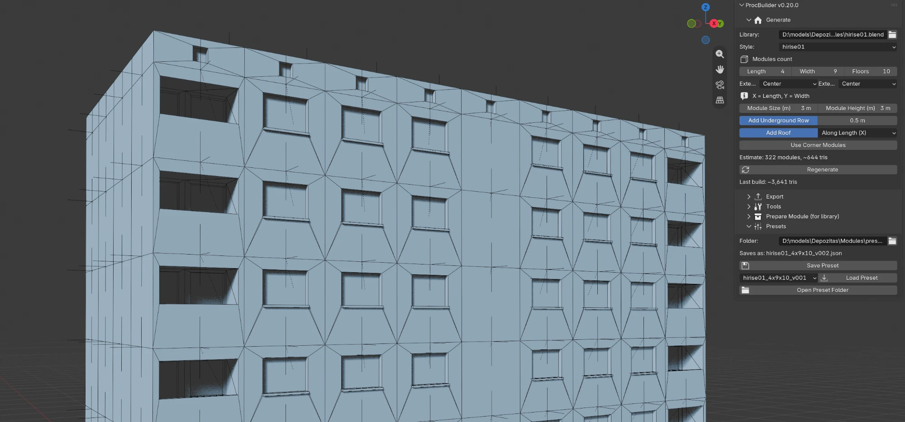

# ProcBuilder

**English** | [Русский](README.ru.md)

ProcBuilder is a free Blender add-on for **quickly assembling buildings from ready-made modules**. You pick a set of modules (walls, roof, balconies...), enter the size, press one button, and a whole building appears. Then you can swap any part by hand to get the look you want.

It is made for **game development and prototyping**: fast results and light geometry, not photorealistic architecture. The building is a plain rectangle with a flat roof; for any other shape, finish it by hand.

## What you need

- **Blender 5.2 or newer**
- A **module library**: a `.blend` file with your wall modules (see [Modules](#what-is-a-module)). To try the add-on right away, download the example library `temp_modules_example.blend` from the [latest release](https://github.com/Ivanou-Dzmitry/ProcBuilder/releases/latest).

## Install

1. Download `procedure_building.zip` from the [latest release](https://github.com/Ivanou-Dzmitry/ProcBuilder/releases/latest). Do not unzip it.
2. In Blender open **Edit > Preferences > Get Extensions**, click the arrow menu in the top-right corner and choose **Install from Disk**, then select the zip.
3. Make sure **ProcBuilder** is enabled.
4. In the 3D Viewport press **N** and open the **ProcBuilder** tab.

## Quick start

1. **Generate** section: set **Library** to your module `.blend` file and pick a **Style**.
2. Set **Length**, **Width** and **Floors**. These are counted in modules, not meters.
3. Optional: turn on **Add Roof** or **Add Underground Row**.
4. Press **Generate**. The panel shows the estimated triangle count before you press and the real one after.
5. Change the numbers and press **Regenerate** to rebuild. Your manual swaps are kept where the slot still exists.

### Change parts by hand

Click a block of the building. In **Edit Block**:

- **Replace with** + **Swap Selected** replaces the selected blocks (you can select many).
- **Swap All Matching** replaces every block that uses the same module.
- **Fill Selected Side** replaces a whole side of the building at once.
- **Add Balcony to Selected** adds a balcony. Balconies are never placed automatically.

### Repeat a building later

Open **Presets** and press **Save Preset**. The file is named after the building, for example `t01_3x23x6_v001.json`, and stores all settings and your manual edits. **Load Preset** rebuilds that building; **Open Preset Folder** shows where the files are.

### Use it in a game engine

Open **Export** and press **Export FBX**. The whole building becomes one clean mesh (seams welded, origin on the ground), and the editable building in your scene stays untouched.

## What is a module

A module is one building block, for example one piece of wall. Modules live in a separate library `.blend` file, one **collection per module**, named `PB_<role>_<Style>`:

| Collection | Used for |
|---|---|
| `PB_bottom_<Style>` | ground floor (the only one required) |
| `PB_middle_<Style>` | floors in between |
| `PB_top_<Style>` | last floor |
| `PB_roof_<Style>` | roof tiles |
| `PB_underground_<Style>` | extra ring below the ground floor |
| `PB_balcony_<Style>` | balconies (added by hand) |
| `PB_bottomcorner_<Style>`, `PB_middlecorner_<Style>` | optional corner pieces |

`<Style>` is any name, such as `Brick01`. One library can hold many styles, and you choose between them in the **Style** list.

You do not have to rename collections by hand: model a module, select it, open **Prepare Module (for library)**, choose a role, type a style name and press **Set Module Name**. A module's front face must look along its local **+Y** axis, and its origin sits on the wall plane at the bottom center. All the details are in the manual.

Looking for modules to start from? [ModuleModo](https://github.com/Ivanou-Dzmitry/ModuleModo) is a companion add-on that generates low-poly wall modules (windows, doors, corners, bay windows, balconies).

## Manuals

Full step-by-step guides with every button and rule:

- [English manual](ProcBuilding_manual_en.md)
- [Русское руководство](ProcBuilding_manual_ru.md)

## Limits

- Buildings are rectangular with a flat roof.
- No floor slabs between stories: only walls, the optional roof and the optional underground ring.
- Corner pieces are supported only for the bottom and middle floors, and are off by default (**Use Corner Modules**).

## Related projects

- [ModuleModo](https://github.com/Ivanou-Dzmitry/ModuleModo): procedural low-poly wall modules for Blender.
- [ConstructionBuilder](https://github.com/Ivanou-Dzmitry/construction-builder): a Blender extension that builds the frame of a building under construction.

## License

GPL-3.0-or-later.
