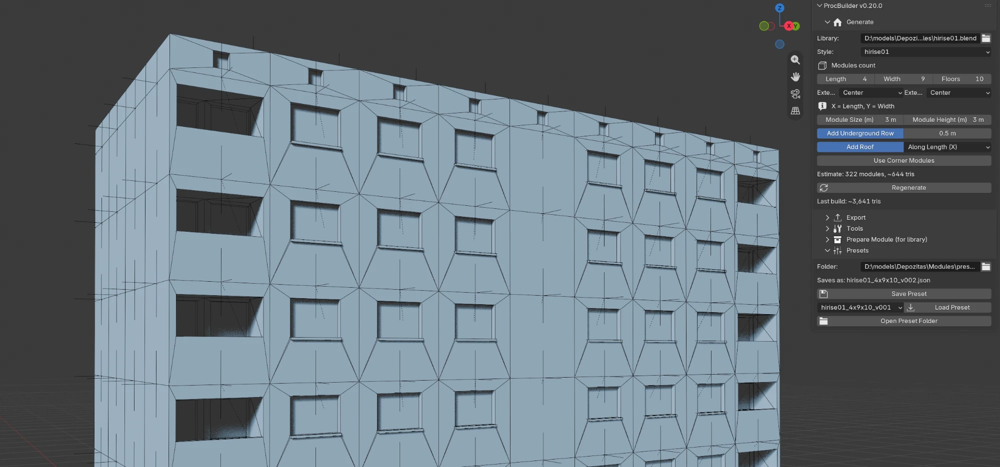

# ProcBuilder

[English](README.md) | **Русский**

ProcBuilder — бесплатный аддон для Blender, который **быстро собирает здание из готовых модулей**. Вы выбираете набор модулей (стены, крыша, балконы...), задаёте размеры, нажимаете одну кнопку — и перед вами целое здание. Дальше любую часть можно заменить вручную, чтобы получить нужный вид.

Он сделан для **геймдева и прототипирования**: важны скорость и лёгкая геометрия, а не фотореалистичная архитектура. Здание получается прямоугольным, с плоской крышей; если нужна другая форма — доработайте вручную.

## Что понадобится

- **Blender 5.2 или новее**
- **Библиотека модулей** — `.blend`-файл с вашими стеновыми модулями (см. раздел «Что такое модуль» ниже). Чтобы сразу попробовать, скачайте пример библиотеки `temp_modules_example.blend` из [последнего релиза](https://github.com/Ivanou-Dzmitry/ProcBuilder/releases/latest).

## Установка

1. Скачайте `procedure_building.zip` из [последнего релиза](https://github.com/Ivanou-Dzmitry/ProcBuilder/releases/latest). Архив не распаковывайте.
2. В Blender откройте **Edit > Preferences > Get Extensions**, нажмите на меню-стрелку в правом верхнем углу и выберите **Install from Disk**, затем укажите zip.
3. Убедитесь, что **ProcBuilder** включён.
4. В 3D Viewport нажмите **N** и откройте вкладку **ProcBuilder**.

## Быстрый старт

1. Секция **Generate**: в **Library** укажите `.blend` с модулями и выберите **Style**.
2. Задайте **Length**, **Width** и **Floors**. Это количество модулей, а не метры.
3. По желанию включите **Add Roof** (крыша) или **Add Underground Row** (подземный ряд).
4. Нажмите **Generate**. Панель показывает ожидаемое число треугольников до нажатия и реальное — после.
5. Меняйте числа и жмите **Regenerate** для пересборки. Ваши ручные замены сохраняются там, где слот остался.

### Заменить части вручную

Кликните по блоку здания. В секции **Edit Block**:

- **Replace with** + **Swap Selected** заменяет выделенные блоки (можно выделить много).
- **Swap All Matching** заменяет все блоки с таким же модулем.
- **Fill Selected Side** заменяет сразу целую сторону здания.
- **Add Balcony to Selected** добавляет балкон. Автоматически балконы не ставятся никогда.

### Повторить здание позже

Откройте **Presets** и нажмите **Save Preset**. Файл называется по зданию, например `t01_3x23x6_v001.json`, и хранит все настройки и ваши ручные правки. **Load Preset** пересобирает это здание, **Open Preset Folder** показывает, где лежат файлы.

### Использовать в игровом движке

Откройте **Export** и нажмите **Export FBX**. Всё здание станет одним чистым мешем (стыки сварены, origin на земле), а редактируемое здание в сцене останется нетронутым.

## Что такое модуль

Модуль — один строительный блок, например кусок стены. Модули лежат в отдельном `.blend`-файле библиотеки, **по одной коллекции на модуль**, с именами `PB_<роль>_<Стиль>`:

| Коллекция | Для чего |
|---|---|
| `PB_bottom_<Стиль>` | нижний этаж (единственная обязательная) |
| `PB_middle_<Стиль>` | промежуточные этажи |
| `PB_top_<Стиль>` | последний этаж |
| `PB_roof_<Стиль>` | плитки крыши |
| `PB_underground_<Стиль>` | доп. ряд ниже нижнего этажа |
| `PB_balcony_<Стиль>` | балконы (добавляются вручную) |
| `PB_bottomcorner_<Стиль>`, `PB_middlecorner_<Стиль>` | необязательные угловые детали |

`<Стиль>` — любое имя, например `Brick01`. В одной библиотеке может быть много стилей, выбирать между ними можно в списке **Style**.

Переименовывать коллекции руками не нужно: смоделируйте модуль, выделите его, откройте **Prepare Module (for library)**, выберите роль, впишите имя стиля и нажмите **Set Module Name**. Лицевая сторона модуля должна смотреть в локальный **+Y**, а origin стоять на плоскости стены, внизу по центру. Все детали — в руководстве.

Нужны модули для старта? [ModuleModo](https://github.com/Ivanou-Dzmitry/ModuleModo) — парный аддон, который генерирует низкополигональные стеновые модули (окна, двери, углы, эркеры, балконы).

## Руководства

Подробные пошаговые описания каждой кнопки и правила:

- [Русское руководство](ProcBuilding_manual_ru.md)
- [English manual](ProcBuilding_manual_en.md)

## Ограничения

- Здания прямоугольные, с плоской крышей.
- Нет перекрытий между этажами: только стены, необязательная крыша и необязательный подземный ряд.
- Угловые детали поддерживаются только для нижнего и средних этажей и по умолчанию выключены (**Use Corner Modules**).

## Связанные проекты

- [ModuleModo](https://github.com/Ivanou-Dzmitry/ModuleModo): процедурные низкополигональные стеновые модули для Blender.
- [ConstructionBuilder](https://github.com/Ivanou-Dzmitry/construction-builder): расширение Blender, которое строит каркас здания на стадии стройки.

## Лицензия

GPL-3.0-or-later.
